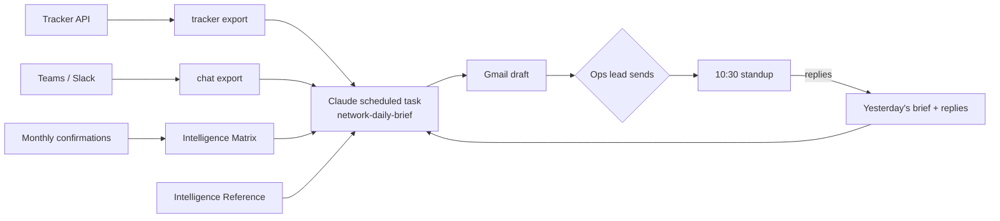

# Network Daily Brief

**An AI operations brief for affiliate and performance-marketing networks.** Every weekday morning Claude reads yesterday's tracker numbers, the team's chats and your network's own history of what advertisers actually paid, then writes the email your team runs its standup from: what happened and why, what could hurt you, where the money you're not making is, and who does what today.

Built and run in production at [ADEO Media](https://adeo.media), a mobile performance network on Affise. Shared so other networks can use it.


*Sample with a fictional network and made-up numbers. Full HTML: [`email-template.html`](skill/network-daily-brief/references/email-template.html).*

---

## What it does

- **Explains, not just reports.** "Revenue rose 6.2%, nearly all from one offer that then capped at 14:20 for the third time this week — the most valuable action today is a cap increase."
- **Finds money left on the table.** Capped offers, idle clean publishers, zero-traffic offers (each with ASSIGN / PAUSE / CHECK), untapped publisher × offer matches, dormant publishers worth reviving — with a dollar estimate.
- **Catches leaks.** Payout bugs (publisher paid, advertiser charged $0), zero-margin offers, click graveyards, concentration risk, margin drift — while knowing which $0s are normal (delayed attribution, manual statuses).
- **Scores new campaigns from chat.** Every campaign an advertiser offers in Teams or Slack gets a score, a verdict and suggested publishers with their track record — based on your confirmed history, not guesswork.
- **Routes every action to one owner**, at most five each, ordered by revenue impact, with an age that turns amber at day 3 and red at day 5.
- **Closes the loop.** The team replies to the brief with what they did; tomorrow's brief reads the replies, marks items fixed and moves on.

Three formats: **Weekend Recap** (Monday), **Daily Brief** (Tuesday–Thursday), **Weekly Recap** (Friday).

## How it works



| Time | Step | Tool |
|---|---|---|
| 07:00 | Export yesterday's tracker stats and the last 24h of chat to Google Docs | Any automation tool (ADEO uses Tasklet) |
| 08:45 | Read everything, write the brief as an HTML Gmail draft | Claude scheduled task + Google Drive + Gmail |
| ~09:00 | A person reviews and sends | Gmail |
| Monthly | Rebuild the Intelligence Matrix when a confirmation month closes | `scripts/matrix_compute.py` + runbook |

The key idea is **two kinds of knowledge**: daily data (fresh every morning) and confirmed intelligence (which advertisers really pay, whose traffic gets scrubbed, which vertical × geo × model combinations work — recomputed monthly). The brief scores today against the last confirmed snapshot. More in [docs/how-it-works.md](docs/how-it-works.md).

## What's in the repo

```
config/brief-config.example.yaml     every network-specific setting: owners, definitions, delays, recipients
skill/network-daily-brief/
  SKILL.md                           the brief's instructions (install as a Claude skill or paste into a Drive doc)
  references/email-template.html     the email design, Gmail- and Outlook-safe, fictional data
prompts/
  scheduled-task.md                  the scheduled-task prompt and schedule settings
  tracker-export-agent.md            export job 1: tracker → Google Doc
  chat-export-agent.md               export job 2: Teams / Slack → Google Doc
  matrix-refresh-runbook.md          monthly Matrix rebuild
templates/
  intelligence-reference.md          the scoring brain: tiers, scores, profiles, formula, 12 failure patterns
  campaign-matrix.md                 the monthly Matrix layout
scripts/
  matrix_compute.py                  tiers, profiles, dormants, untapped matches from confirmation CSVs (stdlib only)
  check_email_html.py                checks a brief survives Gmail / Outlook
examples/                            fictional exports, confirmation CSVs and Matrix output
docs/                                how it works · setup · data contracts · lessons learned
```

## Quick start

1. **Read** [docs/how-it-works.md](docs/how-it-works.md) and open the sample email.
2. **Configure**: copy `config/brief-config.example.yaml` to `skill/network-daily-brief/references/brief-config.yaml` and fill it in.
3. **Export**: set up the tracker export (and optionally chat) following [docs/data-contracts.md](docs/data-contracts.md) and [prompts/](prompts/).
4. **Reference**: create your Intelligence Reference from the template. Parts 1, 8, 9 and 12 work on day one.
5. **Schedule**: install the skill and create the scheduled task — [prompts/scheduled-task.md](prompts/scheduled-task.md).
6. **Run it by hand once**, check the numbers, send it, and ask the team to reply.

Full walkthrough: [docs/setup.md](docs/setup.md). Try the scripts on the samples:

```bash
python3 scripts/matrix_compute.py --adv examples/sample-advertiser-confirmations.csv --pub examples/sample-publisher-payouts.csv
python3 scripts/check_email_html.py skill/network-daily-brief/references/email-template.html
```

## Requirements

- A tracking platform with API access (Affise, Everflow, TUNE, CAKE or similar)
- Google Workspace (Drive + Gmail)
- Claude with scheduled tasks and the Google Drive and Gmail connectors
- An automation tool that can write Google Docs from your tracker (Tasklet, Make, n8n, Zapier, or a script)
- Optional: Microsoft Teams or Slack; monthly advertiser confirmation sheets
- Python 3.8+ for the scripts (no dependencies)

## Before you rely on it

- **Start in draft mode.** A person reviews every brief before the team sees it. Move to auto-send only after weeks of clean drafts.
- **It is only as good as your definitions.** Spend the time on `definitions`, `attribution_delays` and `owners` in the config; most false alarms trace back to one of them.
- **Keep your data private.** The exports copy tracker numbers and business chats into Google Drive. Restrict the folder, and never commit a filled-in Reference, Matrix or export to a public fork.

Hard-won details — Gmail rendering, dates, false alarms, trust — are in [docs/lessons-learned.md](docs/lessons-learned.md).

## License

MIT — see [LICENSE](LICENSE).
