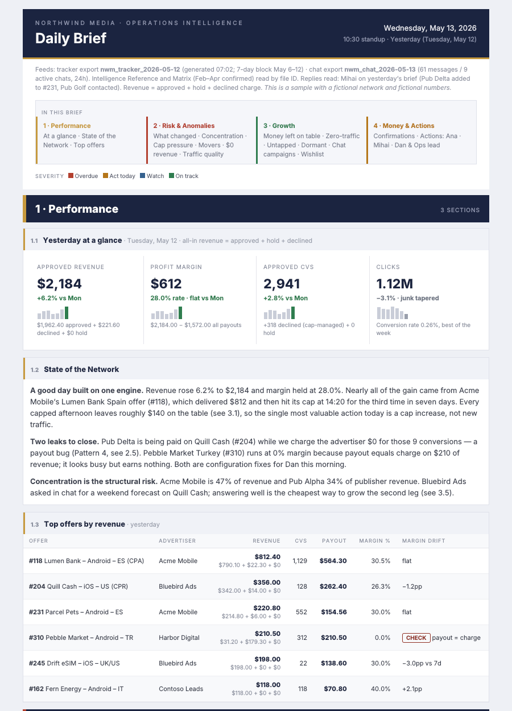
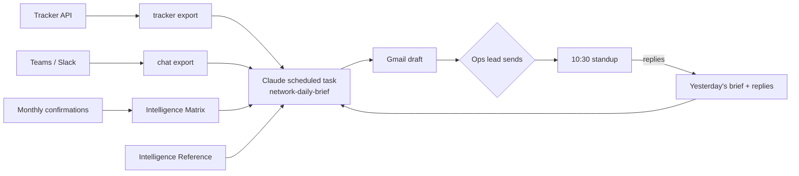

# Network Daily Brief

**An AI operations brief for affiliate and performance-marketing networks.** Every weekday morning Claude reads yesterday's tracker numbers, the team's chats and your network's own history of what advertisers actually paid, then writes the email your team runs its standup from: what happened and why, what could hurt you, where the money you're not making is, and who does what today.

Built and run in production at [ADEO Media](https://adeo.media), a mobile performance network on Affise. Shared so other networks can use it.



*Sample with a fictional network and made-up numbers. Full HTML: [`email-template.html`](skill/network-daily-brief/references/email-template.html).*

---

## What it does

- **Explains, not just reports.** "Revenue rose 6.2%, nearly all from one offer that then capped at 14:20 for the third time this week — the most valuable action today is a cap increase."
- **Finds money left on the table.** Capped offers, idle clean publishers, zero-traffic offers (each with ASSIGN / PAUSE / CHECK), untapped publisher × offer matches, dormant publishers worth reviving — with a dollar estimate.
- **Catches leaks.** Payout bugs (publisher paid, advertiser charged $0), zero-margin offers, click graveyards, concentration risk, margin drift — while knowing which $0s are normal (delayed attribution, manual statuses).
- **Scores new campaigns from chat.** Every campaign an advertiser offers in Teams or Slack gets a score, a verdict and suggested publishers with their track record — based on your confirmed history, not guesswork.
- **Routes every action to one owner**, at most five each, ordered by revenue impact, with an age that turns amber at day 3 and red at day 5.
- **Closes the loop.** The team replies to the brief with what they did; tomorrow's brief reads the replies, marks items fixed and moves on.

Three formats: **Weekend Recap** (Monday), **Daily Brief** (Tuesday–Thursday), **Weekly Recap** (Friday).

## How it works



| Time | Step | Tool |
|---|---|---|
| 07:00 | Export yesterday's tracker stats and the last 24h of chat to Google Docs | Any automation tool (ADEO uses Tasklet) |
| 08:45 | Read everything, write the brief as an HTML Gmail draft | Claude scheduled task + Google Drive + Gmail |
| ~09:00 | A person reviews and sends | Gmail |
| Monthly | Rebuild the Intelligence Matrix when a confirmation month closes | `scripts/matrix_compute.py` + runbook |

The key idea is **two kinds of knowledge**: daily data (fresh every morning) and confirmed intelligence (which advertisers really pay, whose traffic gets scrubbed, which vertical × geo × model combinations work — recomputed monthly). The brief scores today against the last confirmed snapshot. More in [docs/how-it-works.md](docs/how-it-works.md).

## What's in the repo

```
config/brief-config.example.yaml     every network-specific setting: owners, definitions, delays, recipients
skill/network-daily-brief/
  SKILL.md                           the brief's instructions (install as a Claude skill or paste into a Drive doc)
  references/email-template.html     the email design, Gmail- and Outlook-safe, fictional data
prompts/
  scheduled-task.md                  the scheduled-task prompt and schedule settings
  tracker-export-agent.md            export job 1: tracker → Google Doc
  chat-export-agent.md               export job 2: Teams / Slack → Google Doc
  matrix-refresh-runbook.md          monthly Matrix rebuild
templates/
  intelligence-reference.md          the scoring brain: tiers, scores, profiles, formula, 12 failure patterns
  campaign-matrix.md                 the monthly Matrix layout
scripts/
  matrix_compute.py                  tiers, profiles, dormants, untapped matches from confirmation CSVs (stdlib only)
  check_email_html.py                checks a brief survives Gmail / Outlook
examples/                            fictional exports, confirmation CSVs and Matrix output
docs/                                how it works · setup · data contracts · lessons learned
```

## What you need

- A tracking platform with API access (Affise, Everflow, TUNE, CAKE or similar) and a read-only key
- Google Workspace (Drive + Gmail)
- Claude with scheduled tasks and the Google Drive and Gmail connectors
- An automation tool that can write Google Docs from your tracker (Tasklet, Make, n8n, Zapier, or a script)
- Optional: Microsoft Teams or Slack; monthly advertiser confirmation sheets
- Python 3.8+ for the two scripts (no dependencies)

Time: about a day to the first brief, then a week of tuning.

## Step by step

Each step says what to do and what you have when it's done. Details for every step are in [docs/setup.md](docs/setup.md).

### Step 1 — See what you're building

**Do:** open the sample email ([`email-template.html`](skill/network-daily-brief/references/email-template.html)) and read [docs/how-it-works.md](docs/how-it-works.md).

**Outcome:** you know exactly what your team will receive each morning and which parts need which data.

### Step 2 — Create the Drive folder

**Do:** create a folder `Daily Brief/` with `exports/` and `reference/` inside. Share it only with people who already see your tracker and chats.

**Outcome:** one private place where the exports land and the brief's memory lives.

### Step 3 — Fill in the config

**Do:** copy [`config/brief-config.example.yaml`](config/brief-config.example.yaml) to `skill/network-daily-brief/references/brief-config.yaml`. Fill in your network name, time zone, standup time, recipients and owners. Decide what "declined" means in your network. List every offer whose payout arrives days later (`attribution_delays`) and your test offers.

**Outcome:** the brief speaks your network's language, routes every action to a real person and won't raise false alarms about normal delays.

### Step 4 — Export the tracker every morning

**Do:** set up export job 1 with [`prompts/tracker-export-agent.md`](prompts/tracker-export-agent.md), Monday–Friday at 07:00. Run it once and compare three numbers with your tracker's dashboard.

**Outcome:** every weekday at 07:00 a Google Doc `{short}_tracker_{yesterday}` holds yesterday's offer and publisher stats, a 7-day trend and all zero-traffic and paused offers ([format](docs/data-contracts.md)).

### Step 5 — Export the team chat (optional)

**Do:** set up export job 2 with [`prompts/chat-export-agent.md`](prompts/chat-export-agent.md), a few minutes after the tracker export.

**Outcome:** the brief sees new campaign offers, publisher requests and problems raised in Teams or Slack, and scores them.

### Step 6 — Write the Intelligence Reference

**Do:** copy [`templates/intelligence-reference.md`](templates/intelligence-reference.md) into a Google Doc. Fill Parts 1 (definitions), 8 (scoring formula), 9 (failure patterns) and 12 (brief rules) now; they need no history. Put the doc's file ID in the config.

**Outcome:** from day one the brief scores new campaigns, applies hard decline filters and names failure patterns like click graveyards and payout bugs.

### Step 7 — Build the Matrix from confirmed numbers (when you have 3 closed months)

**Do:** export your monthly advertiser confirmations to the two CSVs in [`scripts/matrix_compute.py`](scripts/matrix_compute.py) and run it. Paste the tables into a Google Doc laid out like [`templates/campaign-matrix.md`](templates/campaign-matrix.md). Fill the tier and profile parts of the Reference from the same output.

**Outcome:** advertiser and publisher tiers, success profiles, dormant publishers, untapped publisher × offer matches and win-back advertisers — all from what advertisers actually paid, not from tracked numbers.

### Step 8 — Install the brief and schedule it

**Do:** install `skill/network-daily-brief/` as a Claude skill (or put it in a Drive doc) and create the scheduled task with [`prompts/scheduled-task.md`](prompts/scheduled-task.md): Monday–Friday, at least an hour after the exports, in your local time zone, with `delivery.mode: draft`.

**Outcome:** every weekday at 08:45 a finished HTML brief waits in Gmail as a draft.

### Step 9 — Run it once while watching

**Do:** run the task by hand. Check the date and weekday, that revenue equals approved + declined + hold from the export, that three random numbers trace back to the export, that every action has one owner, and that the draft looks right in Gmail **and** Outlook. If you save the HTML, run `python3 scripts/check_email_html.py brief.html`.

**Outcome:** a first brief you trust enough to send.

### Step 10 — Send it and ask the team to reply

**Do:** send the brief. Ask everyone to **reply to it** with what they did ("paused #183", "added Pub Echo to #245").

**Outcome:** the loop is closed. Tomorrow's brief reads the replies, marks items fixed, ages what's still open and drops what nobody acted on after ten days.

### Step 11 — Keep it current

**Do:** when a confirmation month closes, run the Matrix refresh ([`prompts/matrix-refresh-runbook.md`](prompts/matrix-refresh-runbook.md)). Refresh the Reference once a quarter. Update the owners the day someone changes role.

**Outcome:** the brief keeps scoring today's traffic against the latest confirmed reality.

Try the scripts on the fictional samples before you start:

```bash
python3 scripts/matrix_compute.py --adv examples/sample-advertiser-confirmations.csv --pub examples/sample-publisher-payouts.csv
python3 scripts/check_email_html.py skill/network-daily-brief/references/email-template.html
```

## Before you rely on it

- **Start in draft mode.** A person reviews every brief before the team sees it. Move to auto-send only after weeks of clean drafts.
- **It is only as good as your definitions.** Spend the time on `definitions`, `attribution_delays` and `owners` in the config; most false alarms trace back to one of them.
- **Keep your data private.** The exports copy tracker numbers and business chats into Google Drive. Restrict the folder, and never commit a filled-in Reference, Matrix or export to a public fork.

Hard-won details — Gmail rendering, dates, false alarms, trust — are in [docs/lessons-learned.md](docs/lessons-learned.md).

## The outcome

**Every weekday before standup, your team gets one email that answers four questions:**

| Question | What the brief gives you |
|---|---|
| What happened yesterday, and why? | Revenue, margin, conversions and clicks with 7-day trends, two or three paragraphs explaining the movement, top offers with margin drift |
| What could hurt us? | What changed since yesterday, concentration risk, capped offers, publisher movers, $0 revenue with conversions (each diagnosed: normal delay, payout bug or config issue), wasted clicks |
| Where is the money we're not making? | A dollar estimate of money left on the table, zero-traffic offers with ASSIGN / PAUSE / CHECK, untapped publisher × offer matches, dormant publishers to revive, every new campaign from chat scored with suggested publishers and their track record |
| Who does what today? | At most five actions per person, ordered by revenue impact, each with an age; last month's confirmation status |

**On Monday** it becomes a weekend recap (Friday to Sunday, day by day) with the week's kickoff actions. **On Friday** it becomes a weekly recap with three strategic plays for next week, leaderboards, margin drift, dormant publishers, win-back advertisers and pipeline health.

**After the first week**, the team's replies drive it: fixed items disappear, open items turn amber at day 3 and red at day 5, ignored items drop off at day 10. The standup stops being "what happened?" and becomes "who's doing what?".

**After the first month**, the Matrix turns your confirmed numbers into memory: the brief declines campaigns that look like ones that were scrubbed before, suggests publishers that have actually been paid on similar offers, and spots publishers and advertisers worth winning back.

**What stays with people:** the brief recommends; your team decides and acts in the tracker and with partners. A person reviews every brief before it goes out.

At ADEO Media the brief has run every weekday since spring 2026 and the account managers reply to it daily with what they did. This repository is that system with ADEO's data taken out.

## License

MIT — see [LICENSE](LICENSE).
