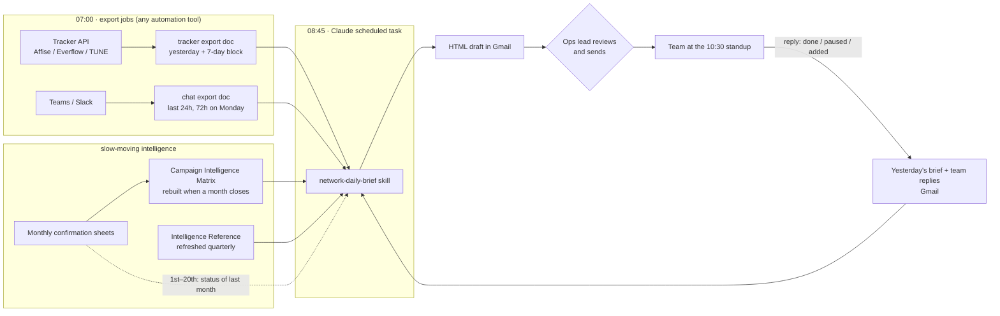

# How it works

## The pipeline

| Time (reference setup) | Step | Tool |
|---|---|---|
| 07:00 | Tracker export: yesterday's offer and publisher stats, 7-day daily block, all offers, zero-traffic and paused offers | Tasklet with Affise API (any automation tool works) |
| 07:05 | Chat export: 24 hours of advertiser, publisher and internal chats (72 hours on Monday) | Tasklet with Microsoft Teams |
| 08:45 | The brief: reads the Reference, the Matrix, both exports, yesterday's brief and the replies to it, the confirmation sheet; writes the HTML email | Claude scheduled task with Google Drive + Gmail |
| ~09:00 | A person reviews the draft and sends it to the team | Gmail |
| 10:30 | Standup runs off the brief | — |
| Afternoon | Owners reply to the brief with what they did | Gmail |
| Weekly / monthly | Matrix refresh when a confirmation month closes; Reference refresh each quarter | Claude scheduled task + `scripts/matrix_compute.py` |

## Two kinds of knowledge

**Daily data** changes every morning: yesterday's revenue, conversions, clicks, caps, chat messages. The brief reads it fresh each day.

**Intelligence** changes monthly: which advertisers actually pay what they track, which publishers' traffic gets scrubbed, which vertical × geo × model combinations have worked. This comes only from confirmed numbers, weeks after the traffic ran. It lives in two documents:

- The **Intelligence Reference** — the scoring brain: definitions, tier tables, geo and vertical scores, success profiles, the scoring formula, hard filters, failure patterns, the publisher-to-vertical map. Refreshed quarterly.
- The **Campaign Intelligence Matrix** — the latest three closed months, recomputed by script: advertiser and publisher tiers, dormant publishers, untapped matches, win-back advertisers, strategic signals. Rebuilt whenever a month closes. Newer than the Reference, so it wins on tiers.

The brief scores today's traffic against the last confirmed snapshot. That is what lets it say "decline this campaign — that vertical was scrubbed 100% for three months" instead of only "revenue is up 6%".

## Three brief types

| Day | Brief | Covers | Emphasis |
|---|---|---|---|
| Monday | Weekend Recap | Fri + Sat + Sun | Day-by-day table, weekend money left on the table, week kickoff actions |
| Tue–Thu | Daily Brief | Yesterday | What changed, anomalies, today's actions |
| Friday | Weekly Recap | Last Fri → Thu | Three strategic plays, leaderboards, margin drift, dormant and win-back lists, pipeline health |

## What the team gets

Every brief is organised in four blocks, each answering one question:

1. **Performance — what happened?** Four KPI tiles with seven-day bars, two or three paragraphs explaining why, top offers with margin drift.
2. **Risk & Anomalies — what could hurt us?** What changed since yesterday (with ages), concentration, cap pressure, publisher and advertiser movers, $0 revenue with conversions (each diagnosed), traffic quality.
3. **Growth — where is the money we're not making?** Money left on the table with a dollar estimate, zero-traffic offers (assign / pause / check), untapped matches, dormant publishers, new campaigns from chat scored one by one, wishlist matches.
4. **Money & Actions — who does what today?** Confirmation status for last month, then one action table per owner: at most five actions each, ordered by revenue impact, each with an age.

See the fictional sample: [`skill/network-daily-brief/references/email-template.html`](../skill/network-daily-brief/references/email-template.html).

## The feedback loop

The brief never assumes an action was taken. Each morning it reads yesterday's brief and the replies to it:

- An item fixed in the data (publisher added and converting, offer paused) or confirmed in a reply → **FIXED**, then dropped.
- An item still open → its age goes up: day 3 amber, day 5 red, day 10 dropped with a one-line note (assume the team chose not to act).
- New items start at day 1.

This is what stops the brief from nagging about the same thing for weeks, and what makes replying worth the team's time.

## Design choices that matter

- **A person sends it.** The task writes a draft; the ops lead reads it before the team does. Wrong numbers are caught before they become decisions. Switch to auto-send only after weeks of clean drafts.
- **Docs read by file ID.** Titles drift and copies multiply; the ID always points at the live version.
- **Instructions in one editable place.** The skill or a Drive doc holds the long prompt; the scheduled task just points at it.
- **Numbers only from sources.** The brief may only use figures from the export, the Reference, the Matrix or the confirmation sheet, and must say when something does not reconcile.
- **Plain language.** No unexplained abbreviations; anyone on the team can read it.
